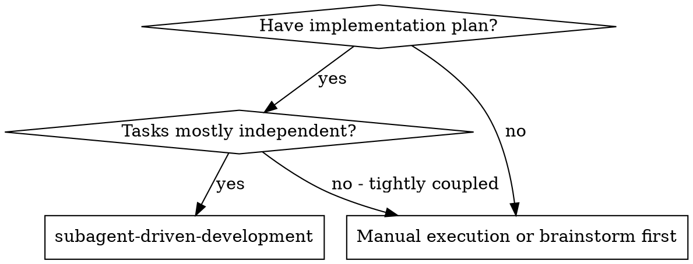

# SDD illustrations

Optional illustrations for the execution contract in [SKILL.md](SKILL.md).

```dot
digraph process {
    rankdir=TB;

    subgraph cluster_per_task {
        label="Per Task";
        "Dispatch implementer subagent (./implementer-prompt.md)" [shape=box];
        "Implementer asks questions?" [shape=diamond];
        "Answer questions, provide context" [shape=box];
        "Implementer implements, tests, commits, self-reviews" [shape=box];
        "Generate review package" [shape=box];
        "Package says docs-only?" [shape=diamond];
        "Dispatch task reviewer (./task-reviewer-prompt.md)" [shape=box];
        "Spec ✅ and quality approved?" [shape=diamond];
        "Finding conflicts with plan text?" [shape=diamond];
        "Rule on the conflict, ledger the ruling" [shape=box];
        "Fix round R of 5: R≤3 resume implementer; R≥4 fresh implementer" [shape=box];
        "Dispatch scoped re-review (./re-review-prompt.md)" [shape=box];
        "All findings addressed?" [shape=diamond];
        "R = 5?" [shape=diamond];
        "Adjudicate each open finding" [shape=box];
        "Any load-bearing finding?" [shape=diamond];
        "Rule and continue; stop only if every path forward is a guess" [shape=box];
        "Park findings in ledger with rulings" [shape=box];
        "Append completion to ledger, mark todo complete" [shape=box];
    }

    "Setup: ledger check, read plan, pre-flight review" [shape=box];
    "More tasks remain?" [shape=diamond];
    "Invoke review <MERGE_BASE>" [shape=box];
    "review: judged findings, ONE fix dispatch, one re-review" [shape=box];
    "Final review clean: delete this plan's workspace" [shape=box];
    "review hands off to finishing-a-development-branch" [shape=box style=filled fillcolor=lightgreen];

    "Setup: ledger check, read plan, pre-flight review" -> "Dispatch implementer subagent (./implementer-prompt.md)";
    "Dispatch implementer subagent (./implementer-prompt.md)" -> "Implementer asks questions?";
    "Implementer asks questions?" -> "Answer questions, provide context" [label="yes"];
    "Answer questions, provide context" -> "Implementer implements, tests, commits, self-reviews";
    "Implementer asks questions?" -> "Implementer implements, tests, commits, self-reviews" [label="no"];
    "Implementer implements, tests, commits, self-reviews" -> "Generate review package";
    "Generate review package" -> "Package says docs-only?";
    "Package says docs-only?" -> "Append completion to ledger, mark todo complete" [label="yes - branch review covers it"];
    "Package says docs-only?" -> "Dispatch task reviewer (./task-reviewer-prompt.md)" [label="no"];
    "Dispatch task reviewer (./task-reviewer-prompt.md)" -> "Spec ✅ and quality approved?";
    "Spec ✅ and quality approved?" -> "Append completion to ledger, mark todo complete" [label="yes"];
    "Spec ✅ and quality approved?" -> "Finding conflicts with plan text?" [label="no"];
    "Finding conflicts with plan text?" -> "Rule on the conflict, ledger the ruling" [label="yes"];
    "Rule on the conflict, ledger the ruling" -> "Fix round R of 5: R≤3 resume implementer; R≥4 fresh implementer";
    "Finding conflicts with plan text?" -> "Fix round R of 5: R≤3 resume implementer; R≥4 fresh implementer" [label="no"];
    "Fix round R of 5: R≤3 resume implementer; R≥4 fresh implementer" -> "Dispatch scoped re-review (./re-review-prompt.md)";
    "Dispatch scoped re-review (./re-review-prompt.md)" -> "All findings addressed?";
    "All findings addressed?" -> "Append completion to ledger, mark todo complete" [label="yes"];
    "All findings addressed?" -> "R = 5?" [label="no"];
    "R = 5?" -> "Fix round R of 5: R≤3 resume implementer; R≥4 fresh implementer" [label="no - next round"];
    "R = 5?" -> "Adjudicate each open finding" [label="yes - breaker trips"];
    "Adjudicate each open finding" -> "Any load-bearing finding?";
    "Any load-bearing finding?" -> "Rule and continue; stop only if every path forward is a guess" [label="yes"];
    "Any load-bearing finding?" -> "Park findings in ledger with rulings" [label="no"];
    "Park findings in ledger with rulings" -> "Append completion to ledger, mark todo complete";
    "Append completion to ledger, mark todo complete" -> "More tasks remain?";
    "More tasks remain?" -> "Dispatch implementer subagent (./implementer-prompt.md)" [label="yes"];
    "More tasks remain?" -> "Invoke review <MERGE_BASE>" [label="no"];
    "Invoke review <MERGE_BASE>" -> "review: judged findings, ONE fix dispatch, one re-review";
    "review: judged findings, ONE fix dispatch, one re-review" -> "Final review clean: delete this plan's workspace";
    "Final review clean: delete this plan's workspace" -> "review hands off to finishing-a-development-branch";
}
```





## Example Workflow

```
You: I'm using Subagent-Driven Development to execute this plan.

[Setup: working in the current checkout]
[Read plan file once: docs/plans/feature-plan.md]
[Resolve workspace: bash scripts/sdd-workspace docs/plans/feature-plan.md — no ledger inside, fresh start]
[Create todos for all tasks]

Task 1: Hook installation script

[Run task-brief for Task 1; dispatch implementer with brief + report paths + context]

Implementer: "Before I begin - should the hook be installed at user or system level?"

You: "User level (~/.config/superpowers/hooks/)"

Implementer: [Later]
  - Implemented install-hook command
  - Added tests, 5/5 passing
  - Self-review: Found I missed --force flag, added it
  - Committed

[Run review-package PLAN_FILE BASE HEAD; dispatch task reviewer with the printed path]
Task reviewer: Spec ✅ - all requirements met, nothing extra.
  Strengths: Good test coverage, clean. Issues: None. Task quality: Approved.

[Ledger: Task 1: complete (commits a1b2c3d..d4e5f6a, review clean)]

Task 2: Recovery modes

[Run task-brief for Task 2; dispatch implementer with brief + report paths + context]

Implementer: [No questions]
  - Added verify/repair modes
  - 8/8 tests passing
  - Committed

[Run review-package PLAN_FILE BASE HEAD; dispatch task reviewer with the printed path]
Task reviewer: Spec ❌:
  - Missing: Progress reporting (spec says "report every 100 items")
  Issues (Important): Magic number (100)

[Fix round 1: resume the implementer with both findings]
Implementer: Added progress reporting, extracted PROGRESS_INTERVAL constant.
  Re-ran test/recovery.test.js — 10/10 passing. Fix report appended.

[Run review-package PLAN_FILE FIX_BASE HEAD; dispatch scoped re-review]
Re-reviewer: Missing progress reporting — ADDRESSED (src/recovery.js:41).
  Magic number — ADDRESSED (src/recovery.js:7). New breakage: none.
  Verdict: all findings addressed.

[Ledger: Task 2: fix round 1/5 (2 addressed, 0 open; commits d4e5f6a..b7c8d9e)]
[Ledger: Task 2: complete (commits d4e5f6a..b7c8d9e, review clean)]

...

[After all tasks]
[Run review-package; invoke review <MERGE_BASE>]
Final reviewer: All requirements met. Deferred minors triaged: none block merge.

[Delete this plan's workspace — the record now lives in git]

Done! review handed off to finishing-a-development-branch.
```
